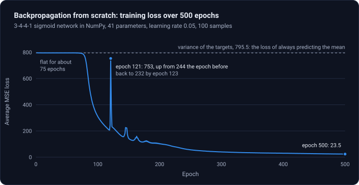

# 2. Backpropagation from scratch

The same 3-4-4-1 network as assignment 1, now with a backward pass for every piece and a training loop, in NumPy only.

```
python assignment2_backpropagation.py
```

## What it adds

- `Layer.backward`: gradients for the weights, the biases and the inputs, then a weight update with a learning rate of 0.05. The input gradient is computed before the weights change.
- `Sigmoid.backward`: the derivative `s * (1 - s)` using the output saved in the forward pass.
- `Loss_MSE.backward`: `2 * (prediction - target) / n`.
- A 500-epoch loop: forward pass, loss, then the backward pass in reverse order. The network has 41 trainable parameters.
- `np.random.seed(0)`, so a run repeats exactly. The code comments explain why the updates are scaled by a learning rate: unscaled steps are far too large for this dataset and the loss blows up.

## Output

`training_log.txt` is the script's own printout (NumPy 2.5, scikit-learn 1.9):

```
Epoch   1 | Average MSE Loss: 796.2023
Epoch  50 | Average MSE Loss: 795.4632
Epoch 100 | Average MSE Loss: 311.3017
Epoch 150 | Average MSE Loss: 143.7912
Epoch 200 | Average MSE Loss: 101.0182
Epoch 250 | Average MSE Loss: 56.1638
Epoch 300 | Average MSE Loss: 39.8508
Epoch 350 | Average MSE Loss: 33.6587
Epoch 400 | Average MSE Loss: 30.1493
Epoch 450 | Average MSE Loss: 25.9849
Epoch 500 | Average MSE Loss: 23.5246
Final Average MSE Loss: 23.524591861261232
```

`loss_per_epoch.csv` has the loss after every epoch. It was recorded by running the same script with one added line inside the loop that stores `average_loss`; the script itself prints only every 50th epoch, and the two agree at those epochs.



## Reading the curve

- **A long flat start.** For roughly the first 75 epochs the loss stays at about 795.5, the variance of the targets, so the network is doing no better than predicting their mean. It then breaks out of the plateau and drops quickly (below 300 by epoch 102).
- **One spike.** At epoch 121 the loss jumps to 753 from 244 at epoch 120 (it was 206 at epoch 119), and is back to 232 by epoch 123, below that 244. That pattern is consistent with a gradient step that overshot; the loss recovers and keeps falling.
- **Still improving.** The loss ends at 23.5 and was still falling slowly at epoch 500.

## Limits

- This is the training loss on all 100 samples. There is no validation or test split, so it says the network learned to fit these 100 points, not that it generalizes.
- One seed and one learning rate (0.05). Other rates, and scaling the targets before training, were not explored in this assignment.
