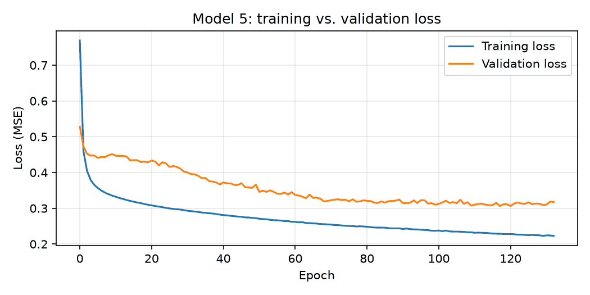

# 3. California housing: ten Keras experiments

A dense neural network that predicts house prices from eight census features, plus nine one-change variations. The metric is mean absolute percentage error (MAPE): how far off each prediction is, in percent, averaged over the test houses.

**Result:** test MAPE fell from 21.33% (base model) to 18.91% (Model 5), with test MAE $34,949 and R2 0.784.



## Files

| File | What it is |
|---|---|
| `assignment3.py` | Runs all ten experiments end to end, then writes the Word report and the best-model script. Roughly 10 to 25 minutes on a laptop CPU. |
| `assignment3_best_model.py` | Stand-alone script for the best model (Model 5). |
| `results.csv` | The ten results, transcribed from the submitted report. |
| `best_model_learning_curve.png` | Training and validation loss for Model 5 over 133 epochs, from the run in the report. |

```
pip install -r ../requirements.txt
python assignment3_best_model.py
```

## Setup

- **Data:** the Keras California Housing dataset (large version, 20,640 samples, 8 features) with `test_split=0.2` and `seed=113`: 16,512 training and 4,128 test samples.
- **Validation:** 15% of the training samples (2,476), used only to decide which changes to keep. The other 14,036 train the model.
- **Inputs:** min-max scaled to [0, 1] with the training minimum and maximum, and the same values applied to validation and test data.
- **Target:** price divided by 100,000, converted back to dollars before every score so all models are scored the same way.
- **Defaults:** seed 42, Adam with learning rate 0.001, batch size 32, MSE loss, ReLU.

## The rule

Each variation changes one thing in the best configuration found so far. If validation MAPE improves, the change is kept; otherwise it is reverted before the next one is tried. The test set only reports each model's final score.

## Results

| # | Model | Hidden layers | Loss | Batch | Epochs run | Val MAPE | Test MAPE | Test MAE | Kept |
|---:|:---|:---|:---|---:|---:|---:|---:|---:|:---|
| 1 | Base model | 64-32 | MSE | 32 | 50 | 21.22% | 21.33% | $38,873 | yes |
| 2 | Wider and deeper network | 128-64-32 | MSE | 32 | 50 | 19.16% | 19.25% | $38,439 | yes |
| 3 | Mean absolute error loss | 128-64-32 | MAE | 32 | 50 | 19.80% | 19.48% | $41,142 | no |
| 4 | Log-transformed target | 128-64-32 | MSE | 32 | 50 | 22.28% | 22.00% | $39,821 | no |
| 5 | **More epochs with early stopping** | 128-64-32 | MSE | 32 | 133 | 18.94% | **18.91%** | $34,949 | yes |
| 6 | Learning-rate reduction on plateau | 128-64-32 | MSE | 32 | 200 | 19.41% | 19.57% | $34,670 | no |
| 7 | Larger batch size | 128-64-32 | MSE | 64 | 95 | 19.64% | 20.04% | $36,498 | no |
| 8 | Dropout regularization | 128-64-32 | MSE | 32 | 102 | 19.73% | 20.04% | $35,887 | no |
| 9 | Batch normalization | 128-64-32 | MSE | 32 | 42 | 20.27% | 20.39% | $37,167 | no |
| 10 | Swish activation | 128-64-32 | MSE | 32 | 196 | 19.53% | 19.61% | $35,549 | no |

Only two of the nine changes were kept: more capacity (Model 2) and longer training with early stopping (Model 5).

## What each change tested

| # | Change | Why I tried it | What happened |
|---:|:---|:---|:---|
| 2 | Added a third hidden layer and doubled the first: 128-64-32. | House prices depend on non-linear interactions such as latitude with longitude (coast against inland), and more capacity can learn them. | Validation MAPE fell from 21.22% to 19.16%. Kept. |
| 3 | Loss function: mean squared error to mean absolute error. | MSE squares errors, so a few very expensive homes (prices are capped at $500,001) dominate training. MAE is closer to how MAPE scores a model. | Both metrics got worse (test MAE $41,142). MAE gives every error a same-sized gradient, so within 50 epochs it had not caught up. Reverted. |
| 4 | Trained on ln(price) instead of price / 100,000, then converted back with exp() before scoring. | MAPE is a relative error. On a log scale a 10% miss is the same size for a $60,000 home and a $450,000 one. | The biggest surprise: MAPE got worse (22.00%). Small log-scale errors are magnified by exp(), and it was tested before early stopping was added, so it may not have converged. Reverted. |
| 5 | Up to 200 epochs with early stopping (watch val_loss, patience 15, restore the best weights). | 50 epochs may stop before convergence. Early stopping trains longer, then stops and keeps the best weights, which guards against overfitting. | Validation MAPE 18.94%, the lowest of all ten. It stopped at epoch 133. Test MAE $34,949, R2 0.784. 11,521 parameters. Kept. |
| 6 | Added ReduceLROnPlateau: halve the learning rate after 5 epochs without improvement (minimum 1e-6). | A fixed learning rate can bounce around the minimum late in training. Smaller steps let the optimizer settle. | Lowest dollar error of all (test MAE $34,670) but MAPE was worse (19.57%): the extra training mainly cut errors on expensive homes while percentage errors on cheaper homes grew. Reverted. |
| 7 | Batch size 32 to 64. | Smoother gradients and faster epochs, unless the noise of small batches was helping the model generalize. | Worse (test MAPE 20.04%). Half as many updates per epoch and less gradient noise; the noise at batch size 32 may have helped. Reverted. |
| 8 | Dropout (rate 0.1) after each hidden layer. | Switching off 10% of neurons at random usually reduces overfitting, which matters more in a bigger network. | Worse (20.04% against 18.91%). Dropout is meant to reduce overfitting, and the validation and test MAPE of this model were already close (18.94% and 18.91%). Reverted. |
| 9 | BatchNormalization between each dense layer and its activation. | Stable layer inputs often speed up convergence and make deeper networks easier to train. | Worse (20.39%). Validation loss became noisier from epoch to epoch and the 15-epoch patience ran out at epoch 42, before the model reached its best. Reverted. |
| 10 | Hidden-layer activation: ReLU to Swish, x * sigmoid(x). | ReLU outputs exactly zero for negative inputs, so some neurons can stop learning. Swish is smooth and passes small negative values. | Close (19.61%) but not better. With inputs scaled to [0, 1] and a network this small, dying ReLU was not a real problem. Reverted. |

## Best model

Model 5: three ReLU layers of 128, 64 and 32 neurons and a linear output, Adam 0.001, MSE loss, batch size 32, up to 200 epochs with early stopping (patience 15, best weights restored). It has 11,521 parameters and stopped at epoch 133. Test MAPE 18.91%, test MAE $34,949, R2 0.784, which is about 81% accuracy measured as 100 minus MAPE.

## What the numbers do and do not show

- One run per model with seed 42. Gaps of a few tenths of a point, such as Models 7 and 8 both scoring 20.04%, are not enough to rank models.
- Regularization did not help here. Dropout (20.04%) and batch normalization (20.39%) both scored worse than the 18.91% of the model they were added to, whose validation and test MAPE (18.94% and 18.91%) were already close.
- Dollar error and MAPE can disagree. Model 6 has the lowest test MAE ($34,670) and a worse MAPE than Model 5, so the metric should match the question being asked.
- Changes were tried once, in a fixed order. Models 3 and 4 were judged at 50 epochs, before early stopping was added, so they were never retried with it.
- The "best model" line in `assignment3.py` picks the lowest test MAPE. Here that is also the model with the lowest validation MAPE, so the pick is the same, but selecting on validation only would be the stricter choice.
