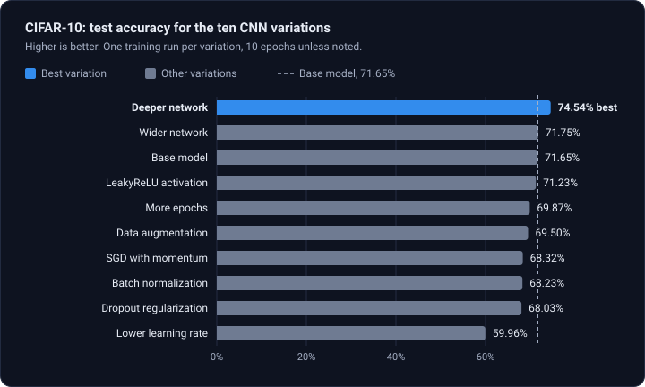

# 4. CIFAR-10 CNN: ten variations

A small convolutional network that classifies 32 by 32 color images into ten classes (CIFAR-10: 50,000 training and 10,000 test images), and nine variations that each change one thing: depth, width, dropout, batch normalization, optimizer, learning rate, augmentation, epochs or activation.

**Result:** test accuracy 71.65% for the base model and 74.54% for the best variation, which adds a third convolutional layer.



## Files

| File | What it is |
|---|---|
| `best_model.py` | The best variation (Deeper network) as a stand-alone script. |
| `results.csv` | The ten results, transcribed from the submitted report. |

```
pip install -r ../requirements.txt
python best_model.py
```

It downloads CIFAR-10 on first use.

## The base model

Two convolutional layers (32 and 64 filters, 3 by 3, ReLU), each followed by 2 by 2 max pooling, then a flatten, a 64-neuron dense layer (ReLU) and a 10-neuron softmax output. Adam with learning rate 0.001, sparse categorical cross-entropy, batch size 64, 10 epochs. Pixels are scaled to [0, 1]. Every variation keeps the loss and the output layer and changes one thing.

## Results

| # | Variation | Architecture | Optimizer (learning rate) | Epochs | Test accuracy | Train accuracy |
|---:|:---|:---|:---|---:|---:|---:|
| 1 | Base model | Conv 32-64, Dense 64 | Adam (0.001) | 10 | 71.65% | not reported |
| 2 | **Deeper network** | Conv 32-64-128, Dense 64 | Adam (0.001) | 10 | **74.54%** | not reported |
| 3 | Dropout regularization | Conv 32-64, Dense 64 + Dropout 0.5 | Adam (0.001) | 10 | 68.03% | 60.12% |
| 4 | Batch normalization | Conv 32-64 (+BN), Dense 64 | Adam (0.001) | 10 | 68.23% | 88.6% |
| 5 | SGD with momentum | Conv 32-64, Dense 64 | SGD, momentum 0.9 (0.01) | 10 | 68.32% | not reported |
| 6 | Lower learning rate | Conv 32-64, Dense 64 | Adam (0.0001) | 10 | 59.96% | not reported |
| 7 | Wider network | Conv 64-128, Dense 64 | Adam (0.001) | 10 | 71.75% | not reported |
| 8 | Data augmentation | Conv 32-64, Dense 64 | Adam (0.001) | 10 | 69.50% | 66.61% |
| 9 | More epochs | Conv 32-64, Dense 64 | Adam (0.001) | 20 | 69.87% | 92.87% |
| 10 | LeakyReLU activation | Conv 32-64, Dense 64 (LeakyReLU) | Adam (0.001) | 10 | 71.23% | not reported |

## What each change tested

| # | Change | Reading |
|---:|:---|:---|
| 2 | A third conv layer (128 filters) to see whether more depth builds richer features (edges, then textures, then object parts). | Best of the ten, +2.89 points. The only change that clearly helped. |
| 3 | Dropout(0.5) after the dense layer so no single neuron can be relied on. | 3.62 points below the base model. Training accuracy (60.12%) sits below test accuracy because dropout is only active while training. |
| 4 | BatchNormalization after each conv layer to stabilize and speed up training. | A 20-point gap between training (88.6%) and test (68.23%): the overfitting pattern. |
| 5 | SGD with momentum 0.9 and learning rate 0.01 in place of Adam. | 3.33 points below Adam at the same 10 epochs. |
| 6 | Adam with the learning rate cut from 0.001 to 0.0001. | The weakest result, 11.69 points below the base model. The report reads it as a rate too cautious to converge in 10 epochs. |
| 7 | Every conv filter count doubled (64, 128) to add capacity through width instead of depth. | +0.10 points. With one run per variation, a gap this small should not be read as a real difference. |
| 8 | Random flips, rotations and shifts of the training images each epoch. | Training accuracy (66.61%) sits below test accuracy (69.50%) because training images are distorted while test images are clean. |
| 9 | The base architecture trained for 20 epochs instead of 10. | Highest reported training accuracy (92.87%) with below-average test accuracy: overfitting. |
| 10 | LeakyReLU in place of ReLU in every conv and dense layer, to avoid neurons stuck at zero. | -0.42 points. With one run per variation, a gap this small should not be read as a real difference. |

## Best model

Conv(32), pool, Conv(64), pool, Conv(128), pool, flatten, Dense(64), Dense(10, softmax), all with `padding="same"`. It has 225,034 trainable parameters (computed from the layer sizes in `best_model.py`) and scored 74.54% on the 10,000 test images.

## What the ten runs show

- **Depth helped and little else did.** The third convolutional layer added 2.89 points. Doubling the filters (+0.10) and LeakyReLU (-0.42) are too small to separate from run-to-run noise.
- **The training-test gap shows overfitting.** More epochs reached 92.87% training accuracy against 69.87% on test, and batch normalization 88.6% against 68.23%.
- **Regularization that only runs during training lowers training accuracy below test accuracy.** Dropout (60.12% against 68.03%) and augmentation (66.61% against 69.50%) both do this, which is expected rather than a bug. In 10 epochs both ended below the base model.
- **A learning rate of 0.0001 was the weakest result (59.96%).** Steps that small did not converge in 10 epochs.

## Limits

- One run per variation and no validation set. The best of ten test scores is probably a little optimistic; a fairer estimate needs a held-out validation split or several seeds per variation.
- The experiments were run by a script called `cifar10_cnn_experiments.py` in the report, which is not in this repository. Only the best model's script is, and the numbers are copied from the submitted report.
- Ten epochs favors setups that learn quickly. Dropout, augmentation and a lower learning rate usually need longer runs to show their benefit, so these results describe a 10-epoch budget only.
