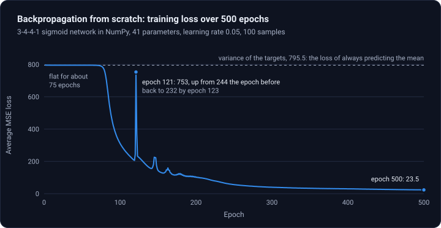
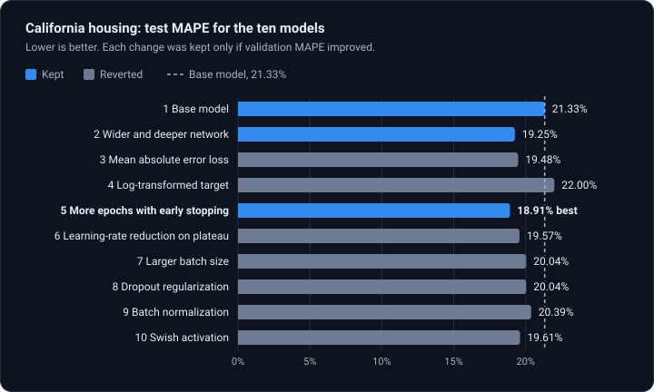
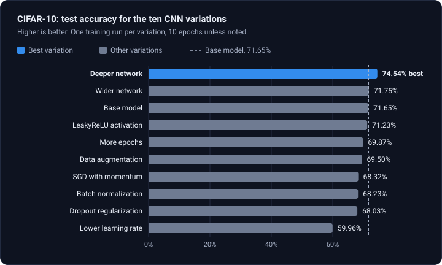

# Neural Networks Coursework

Four graduate assignments that build a neural network up from a hand-written NumPy forward pass to convolutional networks in Keras. Each folder has the code, the numbers recorded for it, and a note on what those numbers do and do not show.

**Interactive walkthrough:** https://muhammad-huzaifa-shafique.github.io/deep-learning.html (scrub through training, step through the experiments)

| # | Assignment | What I built | Result |
|---|---|---|---|
| 1 | [Forward pass from scratch](01-forward-pass/) | A 3-4-4-1 network in NumPy: dense layer, sigmoid activation, mean-squared-error loss | Runs end to end on 100 synthetic samples |
| 2 | [Backpropagation from scratch](02-backpropagation/) | The backward pass for each piece, plus a 500-epoch gradient-descent loop | Training loss 796.2 to 23.5 |
| 3 | [California housing: ten Keras experiments](03-california-housing-keras/) | A dense regression network and nine one-change variations, kept or reverted by validation error | Test MAPE 21.33% to 18.91% |
| 4 | [CIFAR-10 CNN: ten variations](04-cifar10-cnn/) | A small convolutional network and nine variations: depth, width, dropout, batch normalization, optimizer, learning rate, augmentation, epochs, activation | Test accuracy 71.65% to 74.54% |

## Results







## What each assignment shows

**1 and 2: the mechanics, with no framework.** Dense layers, the sigmoid, mean-squared error, the chain rule through each piece and gradient-descent updates, all in NumPy. The loss curve in assignment 2 has a long flat start and a one-off spike, and the notes in that folder explain both.

**3: an experiment with a rule for what to keep.** Each variation changes one thing in the best configuration so far and is kept only if validation MAPE improves. Two of nine changes were kept (more capacity, then longer training with early stopping); neither dropout nor batch normalization helped.

**4: ten variations under one setup.** A third convolutional layer was the only change that clearly beat the base model. The gap between training and test accuracy shows which variations overfit.

## Run it

Python 3.10 or newer.

```
pip install -r requirements.txt
python 01-forward-pass/assignment1_forward_pass.py
python 02-backpropagation/assignment2_backpropagation.py
python 03-california-housing-keras/assignment3_best_model.py
python 04-cifar10-cnn/best_model.py
```

The last two need TensorFlow and download their datasets on first use. `03-california-housing-keras/assignment3.py` re-runs all ten experiments (roughly 10 to 25 minutes on a laptop CPU) and rewrites the Word report and the best-model script.

## Limits

- Each Keras result is a single training run. Differences of about a point or less, such as 71.65% against 71.75% in assignment 4, are not enough to rank two variations.
- Assignment 3 decides which changes to keep with validation MAPE, as intended, but the "best model" line at the end of `assignment3.py` picks the lowest test MAPE. In this run both rules choose Model 5, so the result is the same. Assignment 4 has no validation set, so 74.54% is the best of ten test scores and is probably a little optimistic.
- Changes in assignment 3 were tried once, in a fixed order. The loss and log-target changes were judged before early stopping was added, so a different order could keep a different set.
- The numbers for assignments 3 and 4 are copied from the reports submitted with those assignments. The script that ran the ten CNN variations (`cifar10_cnn_experiments.py` in the report) is not in this repository; only the best model's script is.
- These are course exercises on standard datasets, not production models.

## Topics covered

Neural networks, forward propagation, backpropagation, gradient descent, mean squared error, sigmoid and ReLU activations, regression, MAPE, hyperparameter experiments, early stopping, dropout, batch normalization, learning-rate schedules, convolutional neural networks (CNN), image classification, CIFAR-10, data augmentation, Adam and SGD with momentum, overfitting. Python, NumPy, scikit-learn, TensorFlow, Keras.
